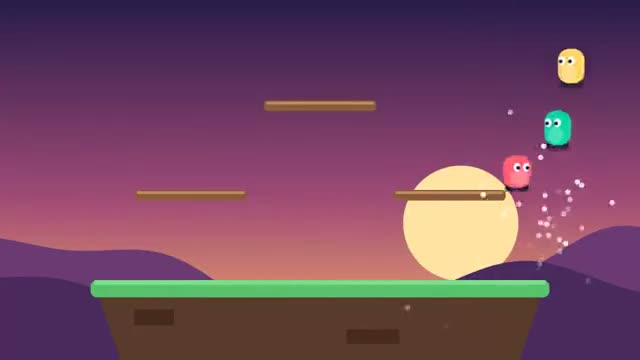

# Platform Brawl

Knock your rivals off the stage. A multiplayer starter game from [Multiplayer Agent](https://multiplayeragent.com): 2D, versus, 2–4 players, with bots that fill empty seats.

## How it plays

Every hit raises the other fighter's damage, and the higher it is, the farther they fly. Fall off three times and you are out. Last one on the stage wins.

**Controls:** Arrow keys with Z and X, or on-screen buttons.

## Make it yours in the Game Builder

Open the [Game Builder](https://multiplayeragent.com), choose **Start from a starter game** and pick Platform Brawl. It opens as version 1 in your studio, ready to play and publish. Then ask for changes, for example:

- Add items that drop from the sky
- Add a stage with moving platforms
- Add a character with a double jump

## Run it yourself

1. Get a free publishable key (`pk_…`) at [multiplayeragent.com](https://multiplayeragent.com).
2. In `index.html`, put it in place of `pk_REPLACE_ME` in the `MP_CONNECT` block.
3. Open `index.html` in a browser. No build step and no server needed.

Without a key it still runs, offline against bots.

## How it is built

- One `index.html`. The comment at the top of the script maps the code and explains the multiplayer.
- **Leaderboard:** The players with the most match wins.
- **Host-run rounds:** The host's browser counts stocks, calls the winner and starts the next match; if it leaves, the next player takes over.
- **Bots:** Bots fill the stage and fight back until enough people join.
- **Live sync:** Every jump, hit and launch shows up for everyone at once.
- `?attract` runs it offline with bots only. The preview video is recorded from it.

## License

MIT.
